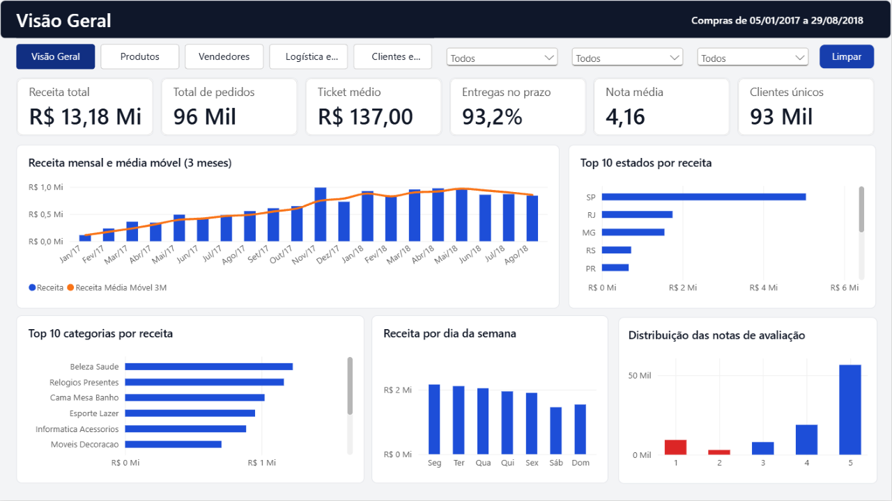
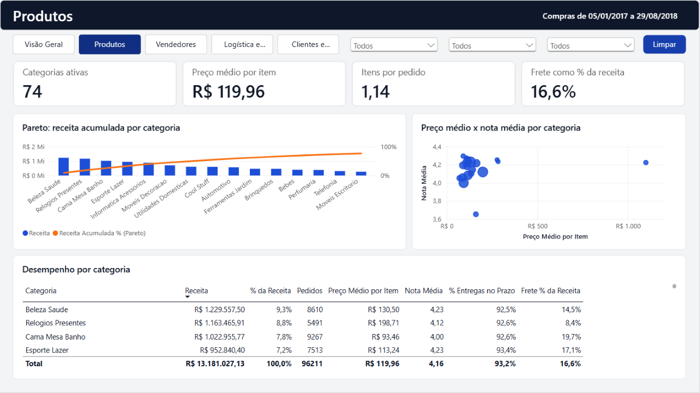
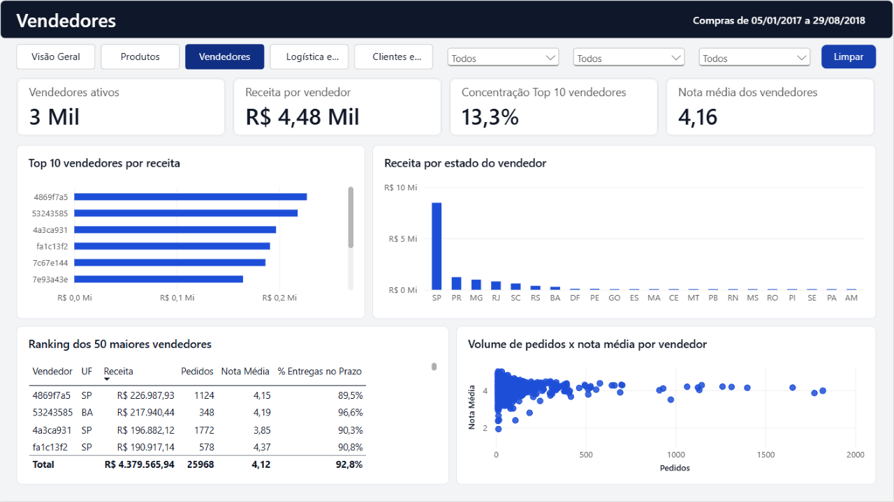
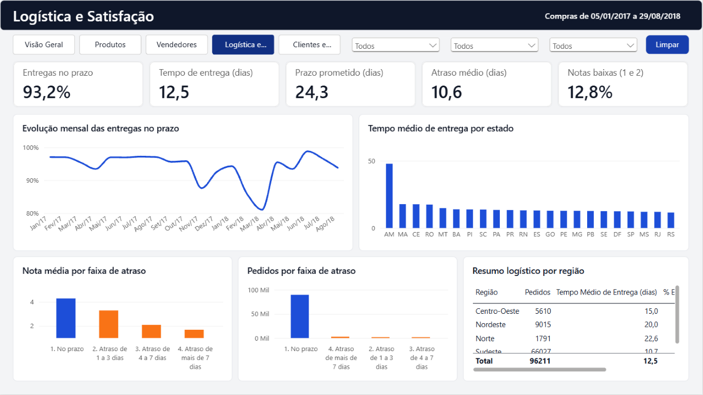
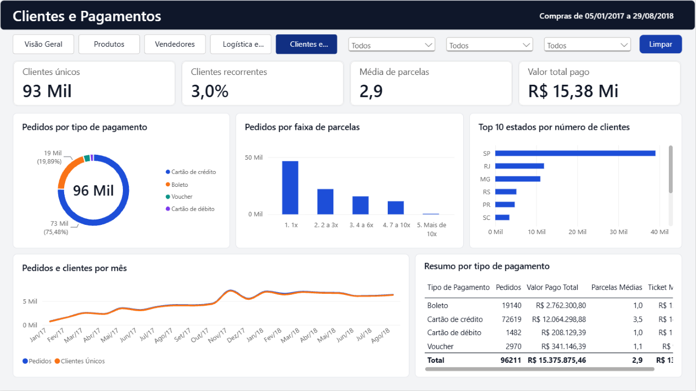
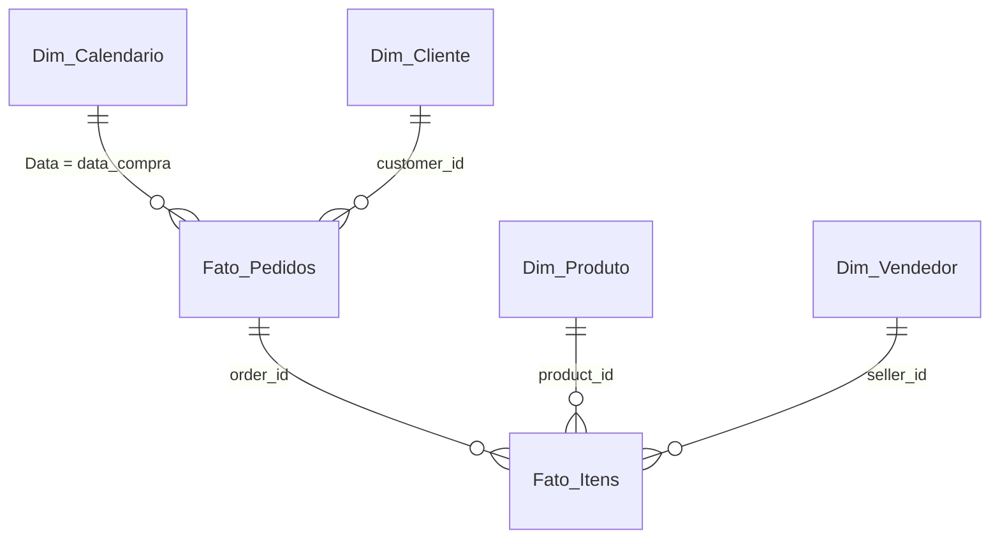

# Dashboard de Vendas e Logística Olist (Power BI)
 
Painel em Power BI feito em cima do **Brazilian E-Commerce Public Dataset by Olist**: cerca de 100 mil pedidos de marketplace no Brasil entre 2016 e 2018. O projeto cobre o caminho inteiro, do banco de dados (PostgreSQL) até o painel final, passando por modelagem dimensional, Power Query e DAX.
 
## O que eu queria descobrir
 
1. Como a receita e o número de pedidos evoluem mês a mês, e qual é o ticket médio do período?
2. Quais categorias e vendedores sustentam a receita? Ela é muito concentrada?
3. A entrega cumpre o prazo prometido? Onde o prazo é pior?
4. O atraso na entrega derruba a nota de avaliação?
5. Quem são os clientes e como eles pagam?

## Resumo rápido (os números que importam)
 
O painel considera só pedidos entregues, com compras de 05/01/2017 a 29/08/2018.
 
- **Receita:** R$ 13,18 Mi em 96 mil pedidos, com ticket médio de R$ 137,00. A receita mensal sobe de cerca de R$ 0,1 Mi em jan/17 para perto de R$ 1 Mi por mês a partir de nov/17, e daí em diante fica nesse patamar (a média móvel praticamente achata em 2018).
- **Concentração:** as 4 maiores categorias juntas respondem por 33,1% da receita (Beleza e Saúde 9,3%, Relógios e Presentes 8,8%, Cama Mesa e Banho 7,8%, Esporte e Lazer 7,2%). Entre os vendedores, o top 10 fica com só 13,3%, ou seja, a receita é bem pulverizada. A concentração mesmo é geográfica: SP responde por quase dois terços da receita por estado do vendedor.
- **Entrega:** 93,2% dos pedidos chegam no prazo. O tempo médio é de 12,5 dias contra 24,3 dias prometidos. As regiões mais lentas são Norte (22,6 dias) e Nordeste (20,0), e o Amazonas se destaca com cerca de 48 dias.
- **Satisfação:** a nota média geral é 4,16. Pedido no prazo tem nota perto de 4,3. Com 1 a 3 dias de atraso, cai para algo em torno de 3,3; com mais de 7 dias, fica abaixo de 2.
- **Pagamento:** cartão de crédito aparece em 75,5% dos pedidos e boleto em 19,9%. Mais da metade dos pedidos é à vista (1x), e a média geral é de 2,9 parcelas.

## Páginas do painel
 
### Visão Geral
 

 
Os seis KPIs principais mais a tendência mensal. Dá para ver que o crescimento foi rápido ao longo de 2017 e depois estabilizou. SP lidera os estados com folga (algo perto de R$ 5 Mi, quase 4 em cada 10 reais), seguido de RJ e MG. Segunda a quinta são os dias mais fortes e o fim de semana cai. Nas notas, a nota 5 domina (cerca de 57 mil avaliações), mas o 1 ainda tem peso, com algo perto de 9 mil.
 
### Produtos
 

 
Aqui o foco é entender o que sustenta a receita. São 74 categorias ativas, preço médio de R$ 119,96 por item e 1,14 item por pedido, então quase todo pedido é de um item só. O frete equivale a 16,6% da receita. Algumas leituras que saltam aos olhos:
 
- Relógios e Presentes tem o maior preço médio entre as líderes (R$ 198,71) e o frete mais leve (8,4% da receita).
- Cama Mesa e Banho é o oposto: preço baixo (R$ 93,46), frete pesado (19,7%) e a nota mais baixa entre as quatro maiores (4,00).
- No gráfico de preço x nota, quase todas as categorias ficam agrupadas na faixa de preço baixo e nota entre 4,0 e 4,3. Preço mais alto não garantiu nota melhor.

### Vendedores
 

 
São cerca de 3 mil vendedores ativos, com receita média de R$ 4,48 mil por vendedor. O maior deles (4869f7a5, de SP) faturou R$ 226.987,93, algo como 1,7% da receita total, o que mostra bem como o marketplace é pulverizado. Os 50 maiores vendedores somam R$ 4,38 Mi, cerca de um terço da receita. No gráfico de volume x nota, a imensa maioria dos vendedores tem poucas centenas de pedidos, e os poucos que passam de mil pedidos mantêm nota perto de 4.
 
### Logística e Satisfação
 

 
A página que responde à pergunta mais interessante do projeto. O prazo prometido (24,3 dias) é bem maior que o tempo real de entrega (12,5 dias), então existe bastante folga na promessa. Mesmo assim, tem meses ruins: a taxa de entregas no prazo cai para perto de 88% em nov/dez de 2017 e chega a cerca de 81% em mar/18.
 
Por região, o Sudeste entrega em 10,7 dias, o Centro-Oeste em 15,0, o Nordeste em 20,0 e o Norte em 22,6.
 
E o atraso pesa na nota: a nota média despenca conforme a faixa de atraso aumenta. Só que a conta não fecha só com atraso. Perto de 93% dos pedidos chegam no prazo, então no máximo cerca de 7% dos pedidos poderiam ter nota baixa por causa de atraso, e as notas 1 e 2 somam 12,8%. Ou seja, atraso explica uma parte da insatisfação, mas não tudo (produto, expectativa e atendimento provavelmente entram nessa conta, algo que o dataset não permite aprofundar).
 
### Clientes e Pagamentos
 

 
São 93 mil clientes únicos para 96 mil pedidos, e só 3,0% deles são recorrentes. Na prática, o marketplace vive de compra única. O cartão de crédito domina (72.619 pedidos, R$ 12,06 Mi, média de 3,5 parcelas), seguido do boleto (19.140 pedidos, sempre à vista). Voucher e débito são marginais. O valor total pago (R$ 15,38 Mi) fica acima da receita (R$ 13,18 Mi) porque inclui o frete. SP concentra cerca de 40 mil dos clientes, bem à frente de RJ e MG.
 
## Leitura de negócio
 
Se um gestor olhasse só para este painel, eu apontaria:
 
**Alavancas**
1. **Recorrência:** com 3,0% de clientes que voltam, qualquer ganho em retenção pesa muito.
2. **Frete e prazo no Norte e Nordeste:** são as regiões com entrega mais lenta, e o frete já é 16,6% da receita.
3. **Categorias de ticket alto e frete leve**, como Relógios e Presentes, que entregam mais receita por pedido.

**Riscos**
1. **Picos de atraso** (fim de 2017 e março de 2018), porque atraso é a maior causa visível de nota baixa.
2. **Dependência de SP**, que lidera em receita, vendedores e clientes.

## Modelo de dados
 
Esquema estrela com duas tabelas fato (itens e pedidos) e três dimensões, mais um calendário gerado no Power Query.
 

 
## Fluxo dos dados
 
```
PostgreSQL (schema olist) > views vw_pbi_* > CSV (DBeaver) > Power Query > modelo estrela > medidas DAX > painel
```
 
## Principais medidas
 
| Medida                         | Definição                                                                         |
|--------------------------------|-----------------------------------------------------------------------------------|
| Receita                        | Soma do preço dos itens de pedidos entregues (sem frete)                          |
| Ticket Médio                   | Receita dividida pelo número de pedidos                                           |
| % Entregas no Prazo            | Pedidos entregues até a data estimada, sobre pedidos com data de entrega          |
| Tempo Médio de Entrega (dias)  | Média de dias entre compra e entrega                                              |
| Nota Média                     | Média da nota de avaliação (avaliação mais recente de cada pedido)                |
| Clientes Únicos                | Contagem distinta de `customer_unique_id`                                         |
| % Clientes Recorrentes         | Clientes com mais de um pedido entregue, sobre clientes únicos                    |
| Concentração Top 10 Vendedores | Parcela da receita que vem dos 10 maiores vendedores                              |
| Receita Média Móvel 3M         | Média mensal da receita nos últimos 3 meses                                       |
| Receita Var. Anual %           | Variação da receita contra o mesmo período do ano anterior                        |
 
Todas as medidas estão em [`dax/medidas.dax`](dax/medidas.dax).
 
## Como reproduzir
 
1. Baixe o dataset no [Kaggle](https://www.kaggle.com/datasets/olistbr/brazilian-ecommerce) e importe no PostgreSQL no schema `olist`.
2. Rode os scripts de [`sql/`](sql/) na ordem numérica.
3. Exporte as 5 views para CSV em `data/` seguindo [`data/README.md`](data/README.md).
4. Abra `powerbi/dashboard_olist.pbix` e, em Transformar dados > Parâmetros, ajuste `pPastaCSV` para a sua pasta `data/`. Atualize.

## Estrutura do repositório
 
```
dashboard-vendas-olist/
├── README.md
├── .gitignore
├── data/             # CSVs exportados (não versionados) e instruções
├── sql/              # views do modelo dimensional e script de validação
├── powerquery/       # parâmetros e consultas M
├── dax/              # medidas DAX
├── powerbi/          # dashboard_olist.pbix
└── images/           # capturas de tela do painel
```
 
## Decisões e limitações
 
- Só pedidos entregues entram no modelo, para receita, prazo e satisfação falarem do mesmo universo.
- O painel usa por padrão o período de janeiro de 2017 a agosto de 2018, porque 2016 e o fim de 2018 têm volume muito baixo no dataset.
- Não há custos no dataset, então o painel mede receita, não lucro.
- O dataset não traz o motivo das avaliações, então a relação entre atraso e nota mostra associação, não causa.
 
## Stack
 
PostgreSQL, DBeaver, Power Query (M), DAX e Power BI Desktop.
